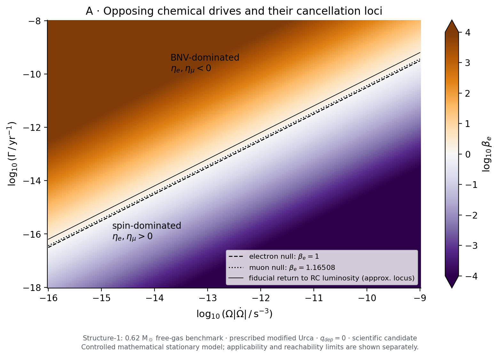
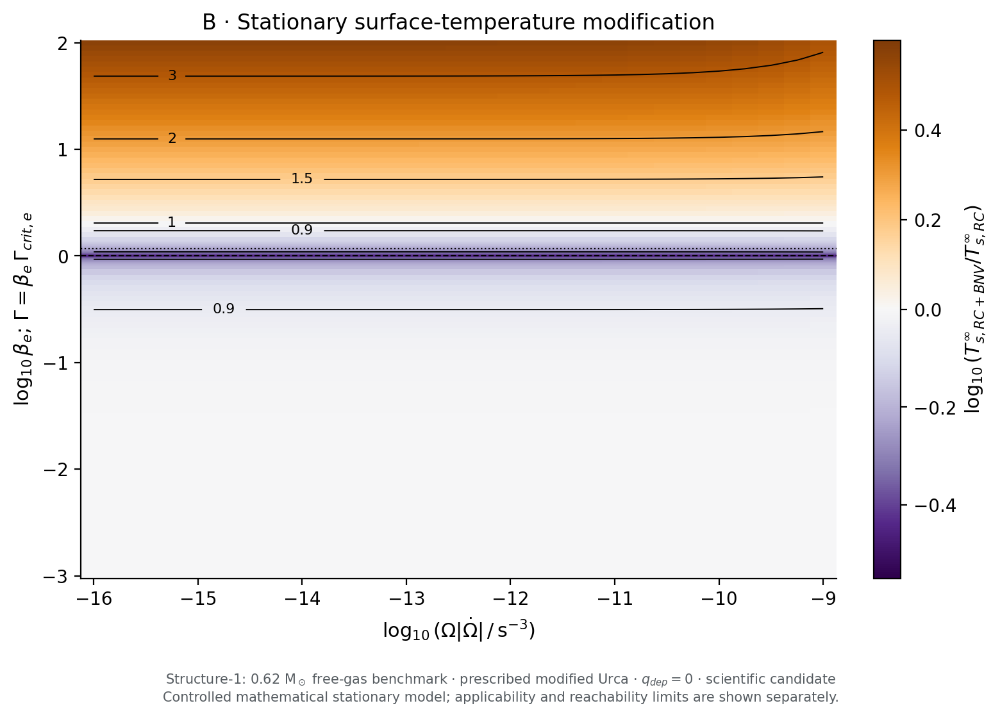
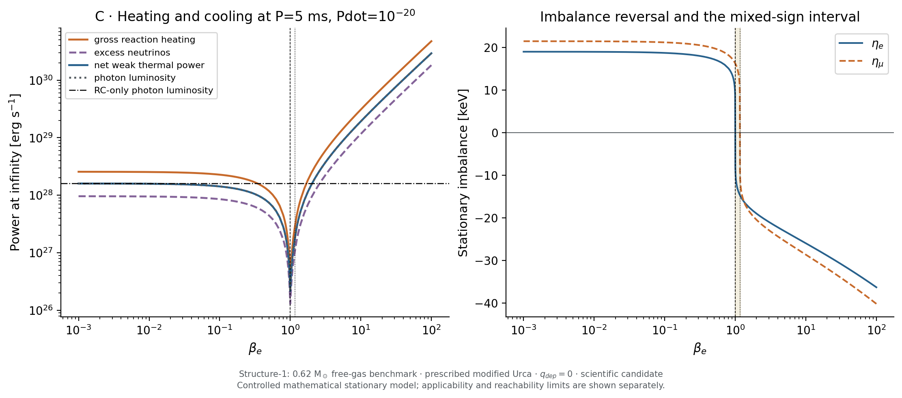
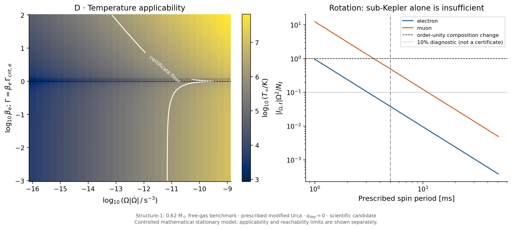
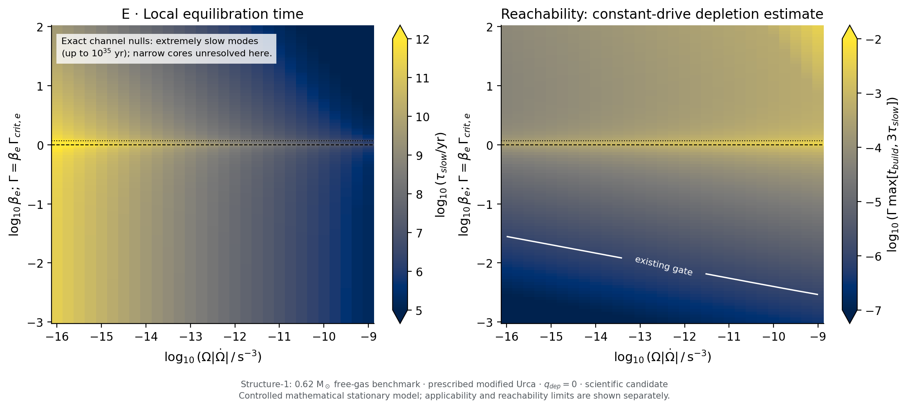
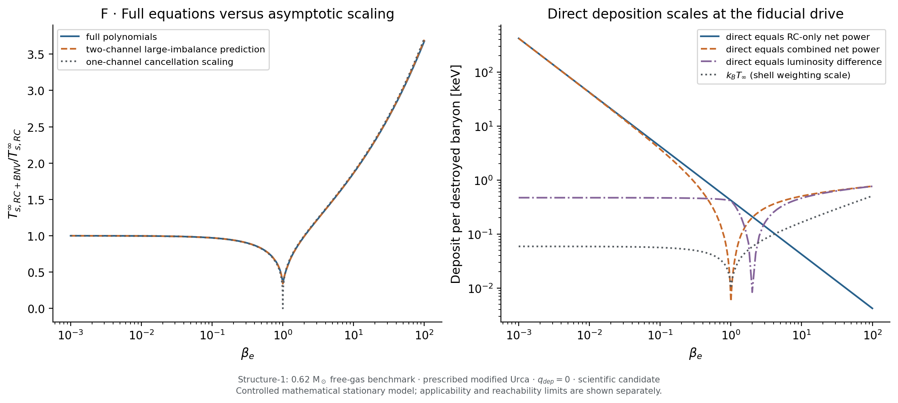

# BNV–rotochemical competition: first controlled results

**2026-11-12 · Structure-1 mathematical benchmark · S1/S2 scientific candidate.**
The owner approved the restricted investigation in [ADR-0025](../../adr/ADR-0025-bnv-retained-energy-study.md).
The new results have independent computational cross-checks, but await independent
scientific review and owner ratification. Stage B's separately ratified result is
[+15,325,803.204209456 K at 2048 yr](../../validation/results-first-bnv-pilot/stage-b/CONDITIONAL_ACCEPTANCE.md);
its seven restrictions, historical failures and numerical evidence remain intact.
Stage B was not rerun.

## Results and the four scientific questions

For a prescribed neutron sink on Structure-1, spin-down and baryon loss drive
the chemical imbalances in opposite directions. Their **combined** reaction
power is nonlinear. With zero direct deposition, BNV initially suppresses
rotochemical emission, produces a deep but nonzero minimum near electron
cancellation, then enhances emission after reversing both channel drives.

At the representative timing point P=5 ms, Pdot=1e-20:

- A 10% reduction in redshifted surface temperature occurs at
  beta_e=0.314184, or Gamma approximately 3.10e-13 yr^-1.
- Electron driving cancels at Gamma=9.8718291e-13 yr^-1. The surface temperature
  is 0.340946 of the RC-only value and photon luminosity is 0.0135127 of it.
  The muon drive still supplies heat.
- Muon driving cancels at beta_e=1.165080, Gamma=1.1501468e-12 yr^-1.
  Between the two nulls, eta_e<0 and eta_mu>0.
- Emission exceeds the RC-only value above beta_e=2.035630
  (Gamma approximately 2.01e-12 yr^-1). At beta_e=3 the surface temperature
  increases by 20.96%; at beta_e=10 it increases by 86.12%.
- Near electron cancellation, **0.413398 keV deposited per destroyed baryon**
  restores the RC-only stationary temperature. Retaining the much dimmer
  zero-deposition solution requires deposition well below **5.66 eV**, its
  own net weak-power scale per event. These are different comparisons.
- **No materially altered stationary regime is established as reachable in a
  physically justified neutron-star model.** The fiducial roots are cold
  extrapolations; the minimum necessary depletion for building their chemical
  reservoir already exceeds the existing 1e-6 frozen-background gate. A
  0.62-solar-mass free-gas star with prescribed MU rates is not a realistic
  millisecond pulsar.

These thresholds are conditional on this star, reaction normalization, envelope,
and actual-potential partition. They are not BNV constraints or universal
neutron-star numbers.

## Inputs, conventions and calculation

All energies, luminosities and times are at infinity; T is the redshifted
interior temperature. Counts are dimensionless. D=-Bdot>0 is in count/s and
Gamma=D/B0 is reported per Julian year. Define d=Omega |Omegadot|>0.
The copied [input manifest](inputs/manifest.json) authenticates native Z, tangent,
MU coefficients and thermal anchors, plus the governed Phase-5D spin coefficients.
No new stellar sequence was solved for S1.

| Quantity | Value / interpretation |
|---|---|
| Mass, radius | approximately 0.62 solar masses; R=12.76617476 km |
| B0 | 7.616906519e56 |
| t_e, t_mu | 0.03085217122, 0.003377743825 |
| I_e, I_mu | -1.163799855e47, -1.484481985e46 count s² |
| Z_ee, Z_e_mu, Z_mu_mu | 4.579303181e-54, 5.172519910e-55, 1.026872798e-52 MeV/count |
| Ltilde_e, Ltilde_mu | 1.812909813e-32, 9.850496858e-34 erg s^-1 K^-8 |
| mu_B at infinity | 868.43543494 MeV |
| Photon mapping | Existing **Iron** envelope, Lgamma=2.774952114e33 (T/1e8 K)^2.42 erg/s |
| Surface mapping | Ts_inf=[Lgamma exp(2 nu_s)/(4 pi R² sigma_SB)]^(1/4), nu_s=-0.07790428019 |

The Iron choice is the actual production default verified against the retained
thermal anchor, regardless of earlier proposal wording. Below the certified
temperature floor this mapping is only a formal extrapolation. Above it, passing
the temperature test alone does not validate a stationary state.

The common chemical variables follow ADR-0014/0015:

\[
\dot{\boldsymbol\eta}
 =-Z(\mathbf R+D\mathbf t+\mathbf s_\Omega),\qquad
\mathbf s_\Omega=-2\mathbf I_\Omega\Omega\dot\Omega
                =2\mathbf I_\Omega d.
\]

Here both components of I are negative, so s_Omega<0, while D t>0.
W=Z I is reused by production. Since Z is positive definite, stationary chemistry
requires R_l=-(D t_l+s_Omega,l) separately in both channels.
For xi_l=eta_l/(k_B T), the complete modified-Urca functions are

\[
 H(\xi)=\frac{14680\xi}{11513\pi^2}
       +\frac{7560\xi^3}{11513\pi^4}
       +\frac{840\xi^5}{11513\pi^6}
       +\frac{24\xi^7}{11513\pi^8},
\]
\[
 F(\xi)=1+\frac{22020\xi^2}{11513\pi^2}
       +\frac{5670\xi^4}{11513\pi^4}
       +\frac{420\xi^6}{11513\pi^6}
       +\frac{9\xi^8}{11513\pi^8}.
\]
\[
 R_l=\frac{\widetilde L_l T^7}{k_{B,\mathrm{erg}}}H(\xi_l),\quad
 L_H=c\sum_l\eta_l R_l,\quad
 \Delta L_\nu=\sum_l\widetilde L_l T^8[F(\xi_l)-1],\quad
 L_{\nu,eq}=\sum_l\widetilde L_l T^8,
\]
\[
 C_\star\dot T=Dc q_{\rm dep}+L_H-\Delta L_\nu-L_{\nu,eq}-L_\gamma.
\]

c=1.602176634e-6 erg/MeV; the displayed q_dep is in MeV per destroyed
baryon. When q_dep is already an energy in erg, P_dir=D q_dep.
All roots here use q_dep=0. H is monotone odd; a signed scalar solve determines
each eta at any trial T, followed by a bracketed thermal solve. This reduction
solves the coupled stationary system without discarding either channel or any
polynomial term. The independent checker instead solves three simultaneous
equations with expanded dimensional polynomials.

The grid covers 30 values of d from 1e-16 to 1e-9 s^-3 and 186 values of
beta_e from 0.001 to 100, including both exact channel nulls and a dense
cancellation interval. It contains 5,580 combined states, 5,580 matched BNV-only
states, 30 spin-only states and one common zero-drive boundary state.
A supplement contains 183 cancellation points and 32 timing/strength examples.
In the zero-drive case the only equilibrium is T=eta_e=eta_mu=0; there is no
positive-temperature stationary control. This boundary is nonlinearly attracting
in the frozen model, with vanishing linear rates, and is outside the certificate.
Temperature ratios are never divided by that boundary value.

## Competition map and channel cancellation

\[
 \beta_l=\frac{D t_l}{2|I_l|d},\qquad
 \Gamma_{\mathrm{crit},e}
 =9.8718291\,10^{-13}
   \left(\frac{\dot P}{10^{-20}}\right)
   \left(\frac{5\ {\rm ms}}{P}\right)^3{\rm yr}^{-1},
 \qquad \beta_\mu=\beta_e/1.165079759.
\]

**Figure A.** The two cancellation curves are distinct because the two drive
vectors are not exactly antiparallel. The solid return-to-RC line uses the
fiducial threshold as an approximate locus; Figure B uses the full numerical
solutions throughout. Neutron loss never reinforces the spin drive component
by component on this star. “Enhancement” above the return threshold means a
larger reversed imbalance and larger emission, not co-directed driving.
The broad Gamma/d plotting rectangle is an analytic ratio map; S1 root samples
occupy beta_e=0.001–100.

**Figure B.** Full stationary surface-temperature ratios. Dashed/dotted lines
mark electron/muon cancellation. The return-to-unity contour, rather than the
sign of a single imbalance, determines enhancement. The minimum located with
the full polynomials is beta_e approximately 1.00000007 and ratio 0.34094606;
its tiny offset from unity is not an astrophysically meaningful precision claim.

| Configuration / beta_e | T_inf [K] | Ts_inf [K] | eta_e [keV] | eta_mu [keV] | Lgamma [erg/s] |
|---|---:|---:|---:|---:|---:|
| Neither | 0 (boundary) | 0 | 0 | 0 | 0 |
| RC only | 683,973 | 58,595 | +19.0071 | +21.4736 | 1.59974e28 |
| BNV only at electron-null Gamma | 678,239 | 58,297 | -19.0072 | -21.0098 | 1.56748e28 |
| Both, 0.3 | 580,090 | 53,037 | +18.0646 | +20.5811 | 1.07378e28 |
| Both, 1 | 115,510 | 19,978 | 0 | +16.2488 | 2.16169e26 |
| Both, 1.165079759 | 276,425 | 33,870 | -14.6997 | 0 | 1.78596e27 |
| Both, 2 | 672,571 | 58,002 | -19.0074 | -20.4749 | 1.53597e28 |
| Both, 3 | 936,715 | 70,874 | -20.9802 | -22.9077 | 3.42409e28 |
| Both, 10 | 1,909,784 | 109,058 | -25.9767 | -28.6453 | 1.91972e29 |

All rows in this table are mathematical stationary results, including the
temperature-gate-passing last row; they are not certified reachable trajectories.
The [fiducial CSV](data/fiducial.csv) gives full precision, matched controls,
signed differences and interaction terms.

Define the four-corner interaction as X_11-X_10-X_01+X_00; this is a diagnostic
contrast, not an independently deposited power. At electron cancellation the
luminosity interaction is -3.14560e28 erg/s, or -0.993175 times the sum of the
two separately driven luminosities. Adding “BNV heating” to “RC heating” would
therefore give the wrong answer even though both isolated mechanisms heat.

## Reaction cooling, chemical work and energy identities

**Figure C.** Excess neutrinos remove part of gross reaction heating.
The net weak power and photon luminosity almost overlap at the fiducial cold
stationary points because equilibrium neutrino emission is then negligible.
A positive net weak power can coexist with suppression relative to RC alone.

| Point | L_H [erg/s] | Delta Lnu [erg/s] | L_H-Delta Lnu [erg/s] |
|---|---:|---:|---:|
| RC only | 2.56124e28 | 9.61500e27 | 1.59974e28 |
| Electron null | 3.45879e26 | 1.29710e26 | 2.16169e26 |
| Muon null | 2.85805e27 | 1.07209e27 | 1.78596e27 |
| beta_e=3 | 5.48406e28 | 2.05997e28 | 3.42409e28 |

With Echem=eta^T Z^-1 eta/2 in MeV, the accepted scoped identities are

\[
 c\dot E_{\rm chem}=A_B+A_\Omega-L_H,\qquad
 A_B=-cD\,\boldsymbol\eta\cdot\mathbf t,\qquad
 A_\Omega=-c\,\boldsymbol\eta\cdot\mathbf s_\Omega,
\]
\[
 \frac{d}{dt}(U+cE_{\rm chem})
  =P_{\rm actual}+A_B+A_\Omega-\Delta L_\nu-L_{\nu,eq}-L_\gamma.
\]

At stationarity A_B+A_Omega=L_H and the second identity separately yields the
thermal balance. At electron cancellation A_B=-2.09522e27 and
A_Omega=+2.44110e27 erg/s: the BNV term removes chemical energy built by spin.
At BNV-dominated negative imbalances its sign reverses and spin work can be
negative. Neither work term is added separately to the thermal equation.

For P-A, mu_n,actual=mu_B+t·eta, escaping energy per event is
(1-f)mu_n,actual and P_actual=c D f mu_n,actual.
At f=0 the escaping luminosity at electron cancellation is 3.31528e34 erg/s,
despite zero direct deposition. The equilibrium reference power obeys
P0=P_actual+A_B, and can be negative: it is not an extra heater.
The spin-off relation between P0 and weak corrections cannot be applied with
the A_Omega term omitted. These are **thermal-plus-chemical subsystem** identities,
not global rotating-star closure; rotational reservoir work and angular-momentum
transport have not been derived here.

## Applicability and reachability

**Figure D.** The temperature contour tests only the existing 1e6 K floor.
The upper 1e9 K gate is not reached by this grid. Rotational composition corrections
are a separate problem: |I_mu| Omega²/N_mu is 0.493 at P=5 ms and 1.97 at
2.5 ms, even though 5 ms is below the conservative dynamical-frequency admission
limit. At 10 and 20 ms it is 0.123 and 0.0308. A 10% line is an illustrative
small-correction diagnostic, never a newly accepted certificate.

All 11,190 nonzero-drive map/control roots have negative real parts for the full
three-variable thermal/chemical Jacobian. This establishes local stability in
the frozen mathematical system, not approach from a stellar birth state.
The independent 55-digit Jacobian check resolves extremely separated modes at
exact channel cancellation.

A rigorous lower bound within the constant-drive, frozen model follows by
writing a=Z^-1/2 eta and b=Z^1/2 R_target. Since eta·R>=0,

\[
 \frac{d\|a\|}{dt}\leq\|b\|,\qquad
 t_{\rm build}\geq
 \sqrt{\frac{\eta^T Z^{-1}\eta}{R_{\rm target}^T Z R_{\rm target}}}.
\]

The stored build_time is this lower bound from eta=0, not a settling-time fit.
It does not apply unchanged to inherited nonzero imbalances or a changing
drive/background. The slowest linear eigenmode defines tau_slow. The separate
max(t_build,3 tau_slow) diagnostic is only a heuristic local settling estimate.
Multiplying either by Gamma estimates constant-sink depletion. Values above
unity simply invalidate the frozen continuation; they do not describe an
actual depleted star. For the prescribed dipole, the driving-change time is
Omega²/(4d), and tau_slow divided by that time diagnoses the quasi-static premise.

**Figure E.** Colors saturate beyond the marked ranges. Exact-null slow modes
are much narrower than map cells; the map does not resolve their width.
The cancellation supplement samples offsets down to 1e-12 plus the exact nulls;
it also does not resolve a thermally linear core narrower than binary64 beta
spacing. The full-polynomial null roots and their eigenvalues are independently
checked. An enormous slow chemical mode is not necessarily the time needed for
an observable surface-temperature tolerance.

At the fiducial drive, the RC-only local slow time is 2.55e7 yr, but its chemical
energy build lower bound is 1.55e8 yr. For beta_e=0.3, 1, and 3, the build bounds
are 2.07e8, 3.78e8, and 9.02e7 yr, requiring at least 6.13e-5, 3.73e-4,
and 2.67e-4 depletion respectively. All exceed 1e-6. At the exact electron
null tau_slow=1.48e22 yr; at the muon null it is 6.47e19 yr. Slow linear
restoration at zero imbalance explains this singular sensitivity. These are
constant-drive diagnostics, not proposed integration horizons.

Of 5,580 combined grid states, 1,545 pass the temperature gate and only 113
also pass the heuristic depletion diagnostic. Those 113 are **not certified
states**: rotation, background response, composition, state-domain and model
validity are additional conditions. Across the entire map, all 3,927 states with at least a 10% surface-temperature
change have a build-depletion lower bound above 1.49e-5, already exceeding the
existing gate; none passes even the two-test diagnostic
([tabulated check](evidence/material-regimes.json)). The CSV's legacy-named
reachable_in_certificate flag means only this two-test diagnostic.
At P=5 ms the rotation composition test is itself poor for every spin-on state.
The research map's imbalances (typically 0.01–0.05 MeV) are also far outside
Stage B's reviewed micro-MeV numerical box. No Stage B accuracy claim is
transferred to them.

Chemical composition departures -Z^-1 eta and equilibrium tangent changes
B0 t Gamma t_build are tabulated separately relative to N_l. At the electron
null these amount to approximately 0.33% and 2.02% of N_mu; the latter is
already based on depletion beyond the existing certificate. The near-threshold
muon population makes composition particularly sensitive.
The 32-row timing table varies P over 2.5, 5, 10 and 20 ms at Pdot=1e-20:
slower spin improves the rotational diagnostic while making relevant stationary
temperatures lower and approach times longer. None of its materially changed
states establishes a fully qualified physical prediction.

## Asymptotic tests and negligible direct heating

**Figure F.** The full roots, rather than the asymptotic expressions, generate
the data. For |xi|>>1, R_l is proportional to eta_l^7,
Delta Lnu/L_H approaches 3/8, and net weak power approaches 5 L_H/8.
In the photon-dominated limit,

\[
 \eta_l\propto\operatorname{sgn}(R_l)|R_l|^{1/7},\quad
 L_\gamma\propto\sum_l C_l|R_l|^{8/7},\quad
 \frac{T_{s,11}}{T_{s,10}}\simeq
 \left[\sum_l w_l|1-\beta_l|^{8/7}\right]^{1/4},
\]

where w_l are the RC-only asymptotic heating weights summing to one.
Measured RC slopes against d are 1.142722 for Lgamma, 0.285681 for Ts_inf,
0.142799 for eta_e, and -0.857422 for tau_slow, close to 8/7, 2/7, 1/7 and -6/7.
The two-channel temperature prediction at electron cancellation is 0.340855,
versus 0.340946 from full polynomials. The single-channel
|1-beta_e|^(2/7) law incorrectly predicts zero temperature there.
Finite-T terms restore linear channel response sufficiently close to a null;
large-imbalance scaling cannot be used for its exactly zero imbalance.
At the high-drive/hot end, equilibrium neutrinos and lower polynomial terms
also limit the simple exponents.

Direct deposition must be compared with the desired effect, not with a single
universal “BNV heating” number. At electron cancellation:

| Comparison per destroyed baryon | Energy at infinity |
|---|---:|
| Absolute chemical work, abs(A_B)/(c D) | 0.054884 keV |
| Combined gross reaction heating, L_H/(c D) | 0.009060 keV |
| Combined net weak power, (L_H-Delta Lnu)/(c D) | 0.005663 keV |
| RC-only net weak power/(c D) | 0.419052 keV |
| Lost photon luminosity/(c D), evaluated at q_dep=0 roots | 0.413389 keV |
| Deposit restoring the RC-only T, with chemistry re-solved at that T | 0.413398 keV |

The last quantity is computed directly from
[Lgamma(T_RC)+Lnu(T_RC,eta_stationary(T_RC))-L_H(T_RC,eta_stationary(T_RC))]/(c D).
It is not a retention-fraction sweep. For beta_e=0.1–0.3, the luminosity-change
scale is about 0.46 keV and the chemical-work scale 0.63–0.65 keV. Thus the
proposal's sub-keV-to-keV estimate is supported for the **broad fiducial
competition effect**, while the residual minimum itself is sensitive to eV
deposition. At these rates a 100 MeV–1 GeV deposit exceeds the approximately
0.4 keV scale by roughly 2.5e5–2.5e6. It generally overwhelms this chemical
modification; it would require solving a substantially hotter balance.

Three physically different statements must remain distinct:

1. **Mathematical zero deposit:** P-A with f=0 makes P_actual exactly zero
   and accounts for all energy escaping. This study establishes that limit
   only as a controlled calculation.
2. **Physically small deposit:** a specified in-medium process must independently
   supply rate-weighted occupied-state selection, kinematics, product spectra,
   reinteractions and escape probabilities. Destruction of a neutron at energy
   E below its chemical potential leaves a hole; relaxation can deposit roughly
   mu_n-E even if decay products escape. Escape alone therefore does not prove
   negligible heating. Near-Fermi selection could reduce this budget, but the
   needed weighting and adequate rate have not been established here.
3. **Large direct deposit:** broad occupied-state sampling, hole relaxation or
   retained/reinteracting products can leave much larger energy. Deposits of
   order 100 MeV–1 GeV lie far outside the chemical-dominance limit at the
   fiducial drive. This is a conditional energy comparison, not a prediction
   that every BNV process deposits that amount.

At fixed beta in the same large-imbalance, photon-dominated limit, the
per-baryon competition energy scales approximately as d^(1/7), since power
scales as d^(8/7) and D as d. Neither that scaling nor the fiducial numerical
threshold should be transferred unchanged across different stellar coefficients
or thermal regimes.

Finite-T weighting matters precisely when the desired deposit is tiny.
At the electron-null root k_B T_inf=9.95 eV, exceeding its 5.66 eV net-power
scale per event. The production partition reports D k_B T as a **diagnostic
scale, not a proven omission bound**. A Sommerfeld-style smooth-weight estimate
of order (k_B T)^2/E_F can be far smaller, but needs a smooth rate kernel and
specified E_F; the CSV's illustrative 100 MeV denominator is not a calculation
of this star's weighted BNV process. Thresholds, shell selection and escaping
spectra can invalidate that estimate. The Stage B finite-T omission estimate
cannot be reused for this cold, tiny-deposition question.

The occupied-state/hole issue is consistent with the rate-averaged heating
discussion in [McKeen, Pospelov & Rajendran (2021)](https://arxiv.org/abs/2105.09951),
whose specific mirror-neutron model is not adopted here. The complete MU
functions and conventional quasi-steady scaling are cross-checked against
[Fernández & Reisenegger (2005)](https://arxiv.org/abs/astro-ph/0502116).
The tracked [Berryman, Gardner & Zakeri (2023)](https://arxiv.org/abs/2305.13377)
paper motivates BNV/timing context; its unresolved statements about heating
versus Urca cooling are **not** used as established conclusions.
Exact PDFs and their provenance remain in [the reference catalog](../../references/README.md);
all seven tracked reference hashes were checked.

## Minimal S2 implementation and short tests

The production extension adds one purpose, PrescribedCombinedDriving; a typed
immutable ParameterizedDipoleHistory; and ActualPotentialPartition.
It reuses the existing chemical equation and reaction owners. The adapter obeys
P(t)^2=P0^2+2 P0 Pdot0 t, with Pdot0>=0 and no extra BNV torque.
Admission requires Omega0<0.3 sqrt(GM/R^3), a conservative imposed slow-rotation
bound, not a relativistic mass-shedding certificate. The historical driver and
its restrictions remain available.

The ledger retains explicit escaping energy and evaluates f mu_actual directly,
avoiding subtraction of two approximately 868 MeV energies at tiny retained
fractions. The equilibrium-reference correction is retained separately using
the actual-potential departure. Tests cover f=0, f=1, 1e-12 and 1e-6, including
an independently evaluated long-double reference and an inconsistent-escape
mutation. This is interface verification, not a retention campaign.

Spin and BNV drive enter exactly once. Diagnostics now include A_B, A_Omega,
the spin reservoir derivative, an independent chain-rule chemical residual,
and the thermal-plus-chemical residual. Neither chemical work nor rotational
reservoir work is inserted again into the thermal equation. Simultaneous
reaction-free runs are explicitly outside this new admission.

The short tests reconstruct the retained complete 15-star archive without a new
sequence solve. Native I differs from the S1 historical I by approximately
3.5e-11 fractionally; native coefficients are exported and used by the independent
short checker. Z, tangent and B match the retained native inputs exactly.

All four cases start at T_inf=1e8 K and eta=0, and run for **one Julian year**.
The spin-on pair shares the same owner, P0=20 ms and
Pdot0=6.1743756495e-19. The BNV-on pair has Gamma=1e-12 yr^-1, chosen to give
beta_e=1.05 initially. Rotation composition diagnostics are 0.002387 (e) and
0.030795 (mu). This slower spin was chosen for the controlled implementation
test, rather than using the physically poor 5 ms composition expansion.

| Case | eta_e at 1 yr [MeV] | eta_mu at 1 yr [MeV] |
|---|---:|---:|
| Neither | 0 | 0 |
| Spin only | +1.0396347141e-10 | +3.0471999929e-10 |
| BNV only | -1.0894196665e-10 | -2.7634377129e-10 |
| Both | -4.9784952461e-12 | +2.8376227995e-11 |

All endpoints have x=ln(T/1e8 K)=-7.1735822696e-6 to the printed precision.
No resolvable temperature separation is required or claimed. At these small
imbalances, excess neutrino power is 1.5 times gross reaction heating to leading
order, so the incremental weak thermal power is negative in all three driven
short cases. Each power was checked independently on its own scale, with maximum
relative disagreement 1.67e-15; large ordinary cooling cannot mask this test.
Each run takes
12 accepted steps and zero rejections at both tested tolerance tiers. Passive
observation scheduling leaves accepted histories and endpoints identical.

In the combined case the independent integrated chemical-energy identity is

    Echem(1 yr) = 1.0872677415e25 erg
    integral A_B dt = +3.5237928265e25 erg
    integral A_Omega dt = -2.4365023464e25 erg
    integral L_H dt = 2.2738606178e20 erg.

Their residual is 1.16e-15 relative to the larger chemical work. The negative
spin work here follows the emerging mixed-sign state; it need not have the
same sign as at either exact stationary null. Direct deposition is zero and
escaping energy is explicitly nonzero in both sink cases.

## Verification, evidence and remaining limitations

[Static verification](evidence/verification.json) passes 13 checks:
independent 55-digit coupled roots; tighter scalar solves; independent
differentiation/eigenanalysis; a second binary64 root solver where nonsingular;
odd rates/even powers; zero-source, channel-null and mixed-sign limits;
dimensional checks; and conventional RC scaling.
Twenty-one representative states span the grid and both nulls. Largest map
chemical and thermal residuals are 8.25e-13 and 1.75e-12; largest subsystem
residual is 2.10e-12. A 301-temperature bracket scan for 15 representative drive
pairs finds one positive-temperature sign change each; this is a check for
missed branches, not a global uniqueness theorem. All sampled positive roots
are locally stable. Heat capacity affects stability/time estimates but not
stationary roots; below its retained cache, only the times use a declared C
proportional to T extrapolation.

[Short independent verification](evidence/short/independent-check.json) passes
all cases and validity checks. Expanded dimensional polynomials and DOP853
agree with the production endpoints to <6e-25 MeV and <5e-20 in x.
Separately scaled chemical and thermal integrals close to <3e-15 and <6e-15
relative, respectively; chemical RHS agreement is <4e-15 relative.
This separately scaled test matters because a large thermal balance can hide
chemical errors. Nine targeted CTest contracts/regressions also pass.
Temperature/depletion, source-currentness, qualified spin type, fast-spin
admission, source reduction, partition endpoints, spin double-counting,
reaction-free refusal and passive observations were exercised. Neither this
check nor the short binary claims Stage B's high-precision global enclosure.

The [execution record](EXECUTION.md) preserves earlier numerical and launcher
failures and their corrections. Source receipts, compact CSVs, figures, logs
and external SHA-256 manifests make the results inspectable. No prior Stage A/B
numerical output, failed certificate or unrelated acceptance was changed.

The remaining physical limitations are material:

- The free-gas 0.62-solar-mass structure and near-threshold muons determine the
  relative drive vectors; realistic masses/EOS may change both cancellation
  separation and susceptibility. In particular N_mu is small.
- MU normalization is prescribed (local SMe=1e-51 and SMmu=2e-51 in the
  benchmark units), not a validated in-medium emissivity for this EOS.
  Absolute imbalances, temperatures and times depend on it.
- Superfluid gaps, their suppression/threshold behavior, direct Urca,
  additional cooling, magnetic envelope effects and realistic envelope
  uncertainty are omitted. They can change reachability and stability.
- Cold response and an unspecified occupied-state source omit physical
  finite-T weighting. Mathematical residuals do not bound this model error.
- Frozen Z, t, I, thermal geometry and composition omit spin-dependent
  structural changes and secular baryon-loss evolution. Sub-Kepler rotation
  alone does not control the near-threshold muon error.
- Common observed/prescribed timing supplies the full imposed spin history.
  BNV-induced angular-momentum changes, torques and moment-of-inertia feedback
  are absent; adding a separate torque without rematching timing would count
  some driving twice.
- Formal local stability, stationarity and heuristic equilibration times do
  not prove attainability from a plausible recycling history. Inherited
  chemical imbalances could alter the build-bound interpretation.
- Existing 1e-6 depletion, 1e6–1e9 K, frozen-response guards and Stage B's
  narrower reviewed numerical domain are unchanged. Static extrapolation
  never grants production admission.

## Next physically meaningful calculation

Repeat the static comparison on **one realistic, specified neutron-star EOS
and mass**, with well-populated muons, consistently computed baryon and rotational
composition derivatives, a stated MU/superfluid model and a temperature range
appropriate to the intended pulsar. At the same time, require an independently
supported occupied-state/escape energy budget before attributing sub-keV deposits
to a microscopic process. This would test whether the two-drive cancellation
and the required energy scales survive in a defensible star.

The current map favors assessing a changing stellar background or a newly
justified physical model before any long approach-to-equilibrium run.
A bare extension of the present certificate would not repair the 5 ms muon
composition problem or establish a tiny direct deposit. **No G-extend,
G-declared, changing-background implementation, S3, microscopic process or
retention campaign has been selected or executed in this round.**
