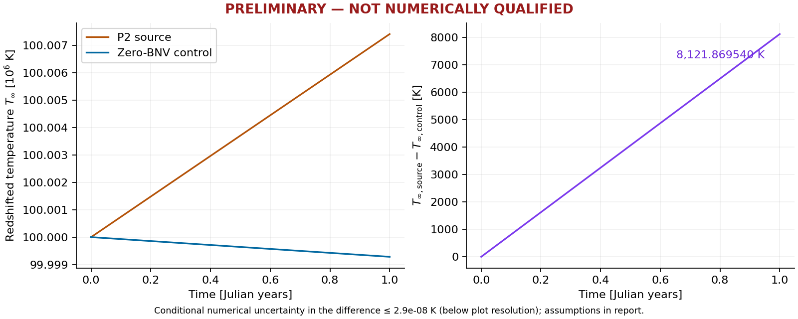
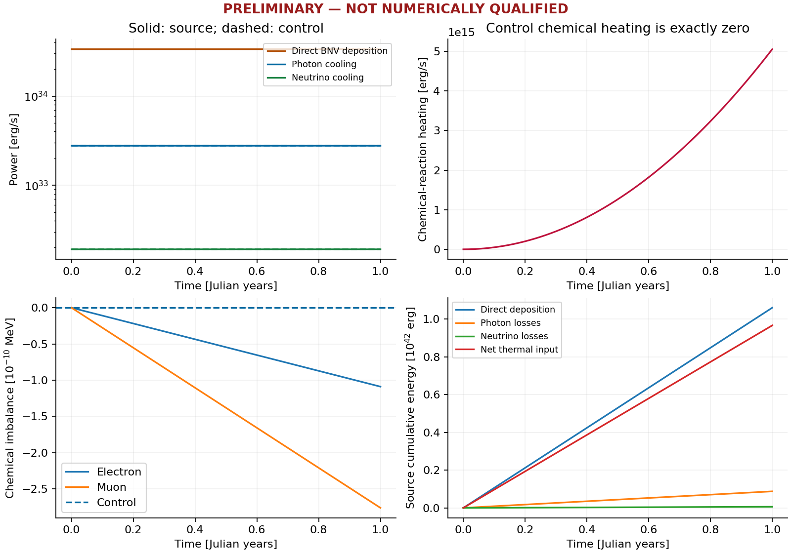

# First matched one-year thermal comparison

**OWNER-ACCEPTED CONDITIONAL PASS — restricted one-year Stage A (2026-11-10)**

The missing source evidence has been recovered. The complete exploratory control
also finished successfully. At one Julian year, the measured finest-reference
source-minus-control redshifted temperature difference is
**+8,121.86954011 K**. The source's **+7,404.513886169 K** rise from its own initial
temperature is a different quantity: the control cooled by **717.355653957 K**.

All computed numerical gates for this one-year, no-crossing trajectory now pass
**conditionally**. The owner accepted the independent review’s CONDITIONAL PASS on 2026-11-10
under GOVERNANCE §5, solely for the scope in [OWNER_ACCEPTANCE.md](OWNER_ACCEPTANCE.md:1).
The sealed evidence retains its original pre-acceptance status fields. This acceptance
does not extend the enclosure or qualify event handling beyond this one-year history.
No Stage B or historical campaign was launched in the work reported here.
The controlled P2 neutron sink is a mathematical full-retention benchmark, not a
realistic decay-rate prediction or an astrophysical constraint.

The curves use the finest retained native RKF45 reference for each role. Both
start at Tinf=100,000,000 K and zero chemical imbalance, with the same certified
stellar inputs and numerical settings. The plotted difference has a conditional
endpoint numerical uncertainty of **1.290e-8 K**, and a maximum over the curve of
**2.824e-8 K**, added between roles without assumed cancellation. These are
conditional enclosures for fixed accepted numerical inputs, not total physical
error bars. The uncertainty is below the figure's resolution.

## Authentication and recovered coverage

Entry was the clean intended commit `191fac300ec3770bc79f505e3afd606075fc65c3` on
`candidate/results-first-bnv-pilot-20261108` in
`/mnt/sdd/zaki/CompactStar/linux-transition-20261010/worktrees/results-first-bnv-pilot`.
All local branch tips were ancestors; nine worktrees were present. See
`evidence/preflight.json` and `SCOPE.md`.

Both existing snapshots were authenticated: source
`cbe2cd7f4042b7586149b28428d6ea86bfe245997a520c5ca82829734b5b8a9f`, control
`880dee60847576fe829dc0c8fd854862c664768a101453d7430f3c1f4bf126e6`.
The original 217,761-file external source manifest passed before reconstruction
and again before sealing the new evidence. Native executables link the retained,
authenticated Release libraries with `-ffp-contract=off`.

The 16-point representative sample reproduced the original four packet files
byte for byte. The remaining unique points then passed the same check. All
**43,248 retained source packets** map exactly to these **1,921 reconstructed
points**, including **1,919 strict interiors** and two exact retained endpoints.
The mapping checks every packet, not a sample. It excludes only the declared
tier/cap/index metadata; state and diagnostic files match byte for byte.

Recovered evidence includes rk8pd/RKF45 /4, /8 and /16 witnesses, accepted witness
steps and RHS traces. The existing 110-digit knot-aligned chemical calculation
was applied to every strict interior. Independent coupled high-precision
calculations additionally cover thermal reconstruction and all state components.
No completed native source trajectory was rerun. New independent high-precision
references did integrate from original t=0, as required to assess global error.

Both roles now have five native references, 12 main histories, 12 identical
endpoint-only repeats, 48 scientific grids, 43,248 passing native packets and
three restart tails. Every main has 12 accepted steps and zero rejections.
All 9,605 stored reference observations per role reproduce exactly; all their
interpolation stages received a prefix-inclusive arithmetic audit. The five
references were also observed at every main accepted endpoint. Control chemical
imbalance, chemical heating, chemical energy and direct BNV deposition remain
exactly zero under the existing owner-checked invariant.

Restart tails branch from retained accepted ordinal 11 at
t=10,025,181.919443566 s, carrying the independently assessed prefix error and
original source time origin. They establish state-restart accuracy; they do not
claim bitwise continuation of an adaptive solver's internal process state.

## Numerical results and their scope

The unchanged criteria are `../native-assembly/NONLINEAR_PLAN.md:95–134`.
The evidence tables retain all quantities rather than replacing thresholds with
measured agreement. `ENCLOSURE.md` gives the candidate derivation; final details
are in `evidence/assessment-final.json`, `evidence/supplement.json` and
`evidence/summary.json`.

| Obligation | Result for this experiment |
|---|---|
| Source chemical reconstruction | All 1,919 intervals pass the existing high-precision chemical check; worst state ratio 0.004797, worst chemical-energy ratio 0.002105 |
| Continuous thermal reconstruction | Analytic RK4/Hermite enclosure, including primary-formula normalization: maximum 3.400e-16 in x versus the existing 1e-12 band |
| Independent coupled local state / Echem | Worst ratios 0.004196 / 0.000952 against stored allowances |
| Control local thermal reconstruction | Worst ratio 0.005300; exact-zero chemical invariant checked |
| Thermal/chemical RHS and accumulated arithmetic | Actual-stage residual recursion, positive Jacobian majorant and domain checks; both methods, both roles, main/reference prefixes and reference interpolation |
| Native reference allocation | Worst source allocation utilization <0.10; control <0.04, including accumulated arithmetic and independently enclosed total reference error |
| State accuracy at scientific times | Worst ULTRA utilization <0.027 for either role; accepted endpoints also pass |
| Eleven diagnostic powers | Reference and main accuracy allocations pass at scientific and accepted times |
| Refinement | Noncontracting differences fit the independently assessed arithmetic allowances; 64 ulps is retained only as the prescribed minimum, not used as a roundoff proof |
| Restart accuracy | Prefix-inclusive ULTRA utilization <0.005 for source and <0.002 for control; three tails per role |
| Matched source-minus-control norms | Pass with uncertainties added; all 1,920 noninitial temperature samples have a conditionally resolved sign |
| R18 / gross power | Source maximum 1.7041e-16, below 1e-10; control also passes |
| R20 and reconstruction/event allocation | Both roles pass conditionally; original residuals and trapezoids retained |
| Domain, rejection, source/fate/currentness guards | Native checks pass; source depletion <=1.000026e-12 and frozen utilization <=3.474841e-6 |
| Actual event crossing | None in either role; zero event contribution is confined to this trajectory. Crossing coverage remains unqualified |

The chemical-only refinement test retains its continued-contraction assumption.
Its 2,676,232 chemical RHS component checks have maximum discrepancies of
0.741 and 0.803 ulp, below the unchanged two-ulp criterion. The source's
conditional accumulated thermal arithmetic enclosure is 2.228e-20 in x for
the main prefix and 3.178e-18 for the finest retained native reference endpoint.
The additional coupled enclosure supplies analytic truncation and continuous
Hermite remainders, so measured refinement agreement is not the sole support for
the local or global accuracy conclusions. The implementation assumes the stated
Decimal arithmetic/elementary-function pads cover their errors; it is not an
outward-rounded interval or machine-checked proof. The fixed geometry caches,
Cstar cells and chemical coefficients remain accepted inputs. BA13 was not
reopened and no stellar background was regenerated.

The thermal RHS defect is systematic, rather than zero-mean roundoff: the native
derivative averages 1.0 ulp (source) and 6.1 ulp (control) below the declared real
RHS. The principal origin is the evaluated photon anchor; binary64 Cstar
interpolation contributes a smaller offset. Actual-stage arithmetic recursion
and the separate primary-formula normalization bound already include both
(independent review F3).

Photon and direct-power normalization were independently reevaluated from the
frozen geometry and source operands. Their propagated one-year temperature
contributions are below 1e-12 K. The declared omitted finite-temperature source
term has a one-year scale of **0.0022855 K**, substantially larger than numerical
temperature uncertainty but negligible relative to the 8,121.87 K benchmark
signal. This is the scale of that declared physical-model omission, not a bound
on every stellar, envelope or physical-source uncertainty.

All twelve main histories per role are bit-identical across all three tolerance
tiers and all four caps. The tolerances never controlled a step; the caps are
inactive. The three restart tails per role are likewise one distinct calculation.
This establishes accuracy of one history per role, not tier/cap convergence or
adaptive-controller behavior (independent review F1). The independent reference methods, actual-path arithmetic assessments
and analytically enclosed high-precision reference provide the accuracy evidence.

## Thermal and chemical energy

These are original 1,920-interval reference trapezoids. Conditional integration
uncertainties, including analytic trapezoid remainders and state/normalization
propagation, are retained channel by channel in `evidence/supplement.json`.

| One-year integrated contribution [erg] | Source | Zero-BNV control |
|---|---:|---:|
| Direct BNV deposition | 1.0598064421e42 | 0 |
| Photon cooling | 8.7578675104e40 | 8.7570068716e40 |
| Neutrino cooling, full | 6.0337532007e39 | 6.0317932326e39 |
| Chemical-reaction heating LH | 5.3161786619e22 | 0 |
| Excess neutrino emission DeltaLnu | 7.9742679929e22 | 0 |
| Net thermal input | 9.6619401379e41 | -9.3601861948e40 |
| Final stored chemical energy | 2.6203934482e27 | 0 |

The source ends at eta_e=-1.0894196614e-10 MeV and
eta_mu=-2.7634376968e-10 MeV. Its net chemical beta contribution,
LH-DeltaLnu, is **-2.6580893310e22 erg**. Chemical heating itself is numerically
resolved as a power/integral; its separate temperature effect is only about
**4.1e-16 K**, so a chemical-heating temperature signal is **SIGN UNRESOLVED**
in this run. The visible thermal separation is overwhelmingly direct deposition.

The source R20 residual remains **-2.6681674272e37 erg** at
N=9.6619401379e41 erg. The independently supported equilibrium-count arithmetic
bound is **6.0603449438e37 erg**. Other terms include U_main=9.8842e29 erg,
U_reconstruction=2.1311e33 erg and U_quad=1.8898e29 erg. The full conditional
total is **9.03414e-5 N**, below **2e-4 N**. The control total is
**6.99436e-9 N**, also below that same threshold. U_event=0 applies only because
there is no crossing; stored reconstruction/event budgets are checked separately.

The source R20 residual is explained to seven significant digits by binary64
baryon-count quantization: B(t)=fl(B0+fl(Bdot*t)). The quantization energy error
is -2.668167526e37 erg; using the exact linear count leaves +9.88e29 erg,
or 1.02e-12 N, on all four grids (independent review F4). These diagnostic
reevaluations do not replace the recorded residual or its conservative bound.

The large source count-subtraction error is exposed and bounded in the ledger;
it is not subtracted from the reported residual. That cancellation-prone count
diagnostic does not drive the integrated thermal state and is not a 0.46 K error
bar on the temperature difference. Exact Decimal reevaluation, analytic thermal
and outgoing-power quadrature remainders, and the original nested-grid terms
are all included without relying on cancellation.

## Execution, preservation and next action

The three control tiers ran concurrently with **24 physical workers each** on
phyn003/004, with 48 GiB per tier and a seven-hour limit. Measured tier walls were
**2,796.61 s, 2,990.12 s and 3,271.81 s** (46m37s, 49m50s and 54m32s).
Five independent native control references ran concurrently as separate histories.
Full source reconstruction took **572.26 s with 24 workers**; the full local
chemical high-precision assessment took **316.51 s with 48 workers**. Continuous
thermal enclosure took **22.64 s with 24 workers**, and arithmetic for all
19,210 reference observations took **9.60 s with 48 workers**. Other phase walls,
allocations and completion receipts are in `evidence/summary.json` and the external
manifest. Slurm accounting is disabled; aggregate CPU usage and simultaneous peak
RSS are unavailable and are not inferred from worker counts.

Filesystem stalls, affinity-guard failures, a compile error and interrupted
preparations are preserved. A supplemental exact-zero assertion caught a tiny
Decimal summation residue in DeltaLnu; the independent evaluator now uses the
exact polynomial identity at eta=(0,0). Native outputs and thresholds did not
change. The strict final contraction check excludes the 64-ulp minimum as a
proof. See `REPRODUCE.md` and preserved attempt logs for the actual failures.
Earlier D1, BA12/BA12R, restart, timeout and preparation evidence remains intact;
this report does not relabel those historical failures.

For clarity, the historical BA12 maximum scaled difference is still
**1.7255917120989046 (FAIL)**. Original BA12R state c1/c2/c3 metrics remain
**32.26041661869904 / 0.9329162771682704 / 43.54669142406804 (all FAIL)**.
Its ledger metrics remain **7.611500166686796e-9 / 0.9329163323161163 /
94.83035685919317 (all FAIL)**, and its matched-difference stability/contraction/
floor metrics remain **21.923678867554578 / 4.101136780587133 /
41.03343563659818 (all FAIL)**. These retain their original definitions and
limits in [the BA12R report](../../PHASE6A1_CONTROLLED_BNV_BA12R.md); they are
separate from this new one-year assessment.

All large outputs, builds and traces remain under
`/mnt/sdd/zaki/CompactStar/linux-transition-20261010/preliminary-pair-20261110-r1`.
The external SHA-256 manifest is independently verified in two complete passes;
`evidence/external-receipt.json` binds its path and hash. Compact evidence, figures,
the temperature CSV, scripts and this report are committed to Git. No laptop
internal storage was used.

The sealed inventory contains **296,997 files totaling 1,524,570,959 bytes**.
Its manifest SHA-256 is
`4ff01cd3172a3bf92b7c5c2df5b69d5b138c6cd80910eeb53e7d22c6177c3992`.
The final artifact job completed with exit 0 in 5m48s; its two-pass hashing and
verification phase took 311.69 s. Figure review also corrected a rounded display
limit upward to 2.9e-8 K; the calculated bound and numerical evidence were unchanged.

The independent review at the external path recorded in `OWNER_ACCEPTANCE.md:1`
completed with CONDITIONAL PASS. The owner accepted that restricted result and
conditionally authorized the predeclared Stage B calculation after its runtime
and piecewise numerical preflight. Stage B's new evidence is recorded separately
in `../stage-b/`; no one-year bound is automatically carried into that horizon.

Changed files are confined to `tools/linux/preliminary_pair/` and this report's
directory. Classes: engineering/evidence collection, independent numerical-method
verification, documentation and generated artifacts. Governing authority:
GOVERNANCE §§1–5; ADR-0014 chemical conventions, ADR-0015 energy accounting,
ADR-0016 ownership, ADR-0017 §§4–6 and Amendment 1. The owner's 2026-11-10 request
explicitly authorizes the exploratory control scheduling exception. No production
equation, solver step, tolerance, acceptance threshold, source definition or
certified stellar input changed. New scientific evidence remains a candidate.
