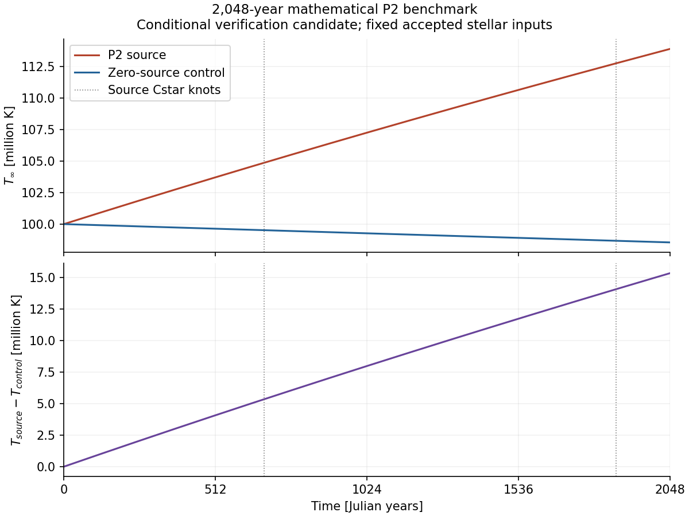
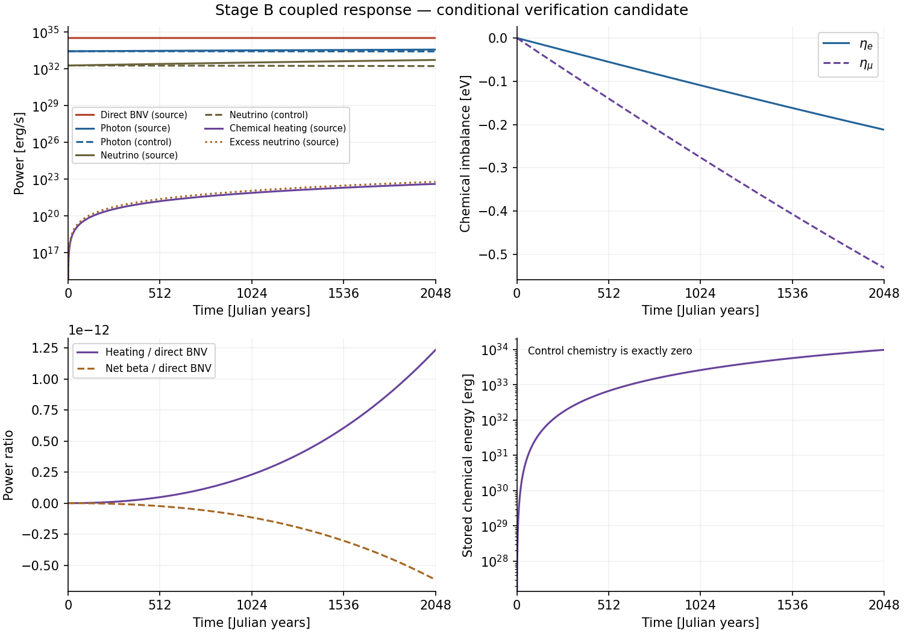
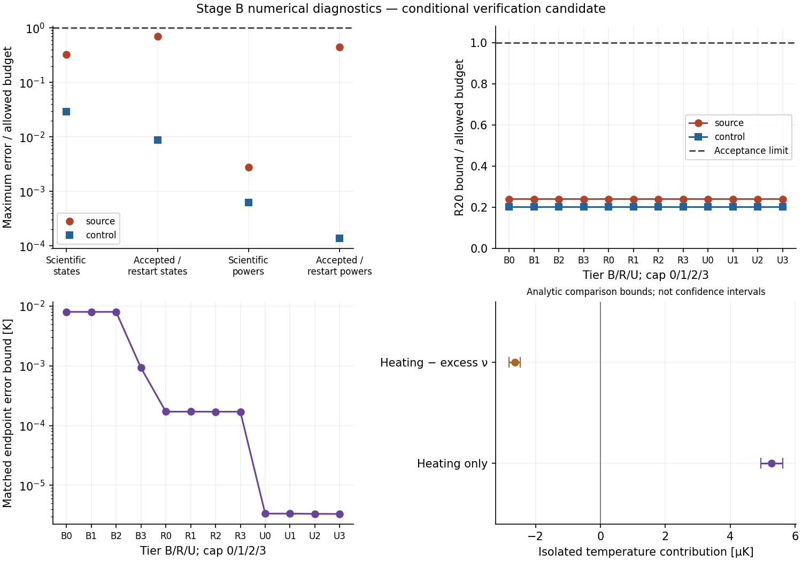

# Stage B — 2,048-year paired thermal evolution

**Independent review: B — CONDITIONAL PASS; OWNER RATIFICATION PENDING.**
All 58 aggregate checks pass, covering the original source/control matrix and
all 12 matched comparisons (`evidence/qualification.json:1`). New verification
remains an **UNVERIFIED SCIENTIFIC CANDIDATE** under GOVERNANCE §5 pending owner ratification. Independent review
of `49253200a801ad9b336789dffb4e93d535a8e903` found no load-bearing error and
requires no numerical correction (`review-evidence/REVIEW.md:17`). This is not
owner acceptance of Stage B. The earlier handoff in [STATUS.md](STATUS.md) is a
historical checkpoint, superseded by this completed analysis.

The source becomes 15.326 million K warmer than the control. Chemical reactions
oppose 12–15% of instantaneous chemical driving at the endpoint, but isolated
gross reaction heating contributes only **+5.19 µK**. The **combined chemical
response is −73.1 µK (cooling)**, dominated by actual-potential chemical storage.
These are fixed-input mathematical diagnostics, thermally negligible here
(`review-evidence/REVIEW.md:281`). The [draft acceptance record](CONDITIONAL_ACCEPTANCE.md)
retains all seven review conditions; no owner decision is recorded.

The scoped Stage A CONDITIONAL PASS is recorded in
[OWNER_ACCEPTANCE.md](../preliminary-pair/OWNER_ACCEPTANCE.md). Its accepted matched
one-year endpoint is +8,121.86954011 K. Historical failures, original thresholds,
and immutable Stage A evidence remain unchanged. The Stage A report now explicitly
records identical histories across every tier/cap, the thermal RHS systematic
offset, and R20 count quantization. Those one-year conditions are not assumed for B.

## Physical result within the fixed-input mathematical experiment

Both original-t0 roles reached exactly 64,629,964,800 s (2,048 Julian years).
All five separately run native references per role completed. They share the
production RHS and anchors, so their mutual comparison tests discretisation,
not independent implementation. The candidate Decimal and reviewer mpmath
models are independent implementations of the declared model
(`review-evidence/REVIEW.md:406`). The independent
piecewise high-precision reference gives:

| Endpoint quantity | Source | Zero-source control |
|---|---:|---:|
| Redshifted temperature T∞ | 113,875,356.00171844 K | 98,549,552.79750898 K |
| Electron imbalance | −2.1199137019465853e−7 MeV | exactly zero |
| Muon imbalance | −5.311266839549596e−7 MeV | exactly zero |

Matched temperature difference: **+15,325,803.20420946 K**. The finest native
RKF45 reference difference is +15,325,803.20420949 K. These are different numerical
representations, not interchangeable last-digit claims. The new fixed-input
primary-formula high-precision endpoint enclosure for the matched difference is
7.47e−9 K; this is a candidate reference bound, not the error bar for a native
main trajectory or an absolute stellar error bar. Native matched endpoint bounds
are reported separately below. Numerical source: `evidence/final-summary.json:1`,
fields `paired_HP_endpoint` and `matched_configurations`.
Printed values and Git CSV copies are rounded for display. Verification enclosures
apply to the archived full-precision strings; add display-rounding error when
using a rounded representation at nanokelvin precision.

The uncertainty classes must remain separate next to this headline result
(review correction D4; `review-evidence/REVIEW.md:205`):

| Class | Meaning and scale |
|---|---|
| Numerical, fixed inputs | HP endpoint enclosure 7.47e−9 K; coarsest native endpoint bound 0.008022 K (maximum grid deviation 0.00824 K). These are conditional deterministic bounds. |
| Omitted model term | Finite-temperature source weighting has a ~6.26 K scale, not included in the numerical enclosure and not a total model-error estimate. |
| Fixed accepted inputs | Cstar table, Urca coefficients, tangent, anchors and frozen background are held as given. BA13/static uncertainties are not requalified or combined into a stellar error bar; depletion is 2.048e−9. |



The vertical markers are actual source Cstar crossings. The reference enclosure
is much narrower than a plotted stroke; it is quantified above, not displayed
as a visible band. [Vector PDF](evidence/temperature.pdf).

The mathematical source's direct deposition dominates the thermal separation.
At the endpoint, direct deposition is 3.3583239603e34 erg/s, photon cooling
3.8002790062e33 erg/s, and full neutrino cooling 5.4049654469e32 erg/s. Source
chemical heating is only 4.1450912065e22 erg/s, while excess neutrino losses are
6.2176368096e22 erg/s. Chemical energy stored is 9.8695948979e33 erg. Control
endpoint photon and neutrino powers are 2.6785500459e33 and 1.7005609542e32 erg/s.
The observed excess-neutrino/heating ratio is approximately 1.5, so the net
reaction term cools despite the positive heating channel. Heating/direct deposition
is only about 1.23e−12 at the endpoint.
The equilibrium-potential deposition is 3.3583239602973852e34 erg/s; the actual
deposition is lower by approximately 3.223e23 erg/s (9.60e−12 of deposition),
consistent with the source contribution to chemical-energy storage. The isolated
LH and net-reaction temperature bounds below do not represent the total effect
of every chemical coupling, including this actual-potential correction.
The muon imbalance is only about 5.4e−5 of kB T∞ at the endpoint, consistent with
the very small thermal contribution from reactions in this benchmark.
Thermal insignificance does not imply absent chemical relaxation. At the endpoint,
the reaction terms oppose about **12.3% of electron and 15.1% of muon source
driving** in the imbalance derivatives. Reaction losses remove about 12.9% of the
instantaneous source input to the chemical-energy reservoir. The imbalances
continue growing in magnitude; they have not reached stationary balance. These
are instantaneous term ratios, not integrated suppression fractions or a new
counterfactual trajectory. Both chemical derivative components are included in
the retained source/control curves.

The retained 1,920-interval trapezoids give the following descriptive integrated
channels. These channel integrals are not assigned the total-ledger error bar.

| Integrated channel [erg] | Source | Control |
|---|---:|---:|
| Direct BNV deposition | 2.17048359e45 | 0 |
| Chemical heating | 7.79464697e32 | 0 |
| Excess neutrino loss | 1.16919705e33 | 0 |
| Full neutrino cooling | 2.22889132e43 | 1.16575820e43 |
| Photon cooling | 2.12429843e44 | 1.76205797e44 |
| Net thermal power | 1.93576484e45 | −1.87863379e44 |

The new analytic coupled comparison in [CHEMICAL_RESPONSE.md](CHEMICAL_RESPONSE.md)
bounds the temperature contribution of LH alone by **+4.936 to +5.615 microkelvin**
(display bounds rounded outward). The net reaction term LH−DeltaLnu contributes
**−2.812 to −2.464 microkelvin**.
These bounds include the response of both chemical variables, thermal damping,
cell changes, and the high-precision/normalization uncertainty. They compare
vector fields analytically; the candidate analysis ran no extra counterfactual
trajectory. The reviewer separately integrated the diagnostic equations below. The
relative half-width is about 6.43% for LH and 6.58% for the net term, below the
existing 10% resolved-signal criterion. Both intervals explicitly add an 8.12e−9 K
allowance on each side for normalizing both comparison flows, without cancellation.
The earlier narrower preview remains preserved; this additional allowance changes
no trajectory or threshold.
Thus this contribution is conditionally numerically resolved by the new comparison
verification, but physically negligible in this experiment. It is not resolved
merely by comparing the baseline native trajectory or by subtracting two rounded
temperatures. The omitted finite-temperature source scale alone is about 6.26 K;
accepted stellar inputs are held fixed, with no new absolute-accuracy claim.
The total R20 uncertainty is much larger than the chemical energy terms. The
microkelvin conclusion comes from the separate coupled comparison enclosure;
a passing total-energy balance alone cannot resolve this contribution.

### Complete chemical-channel interpretation (review correction D1)

Define each response as **T_full − T_term-suppressed** at 2,048 yr, starting
from the same initial state and retaining both coupled composition equations.
The reviewer obtained the values by integrating term-suppressed **diagnostic
three-ODE evolution equations** with independent mpmath RK4 code. They are not
additional native solver trajectories, stellar evolutions, or physical alternative
models. This documentation closeout imports existing results and runs no evolution.

| Channel suppressed in the diagnostic thermal equation | Endpoint response | Evidence class |
|---|---:|---|
| Gross weak-reaction heating, LH | **+5.19 µK** (+5.1886501) | Independent estimate inside the existing analytic interval |
| Net weak-reaction effect, LH−DeltaLnu | **−2.59 µK** (−2.594325) | Independent estimate inside the existing analytic interval |
| Actual-potential chemical-storage channel, P_actual−P_eq (replace P_actual by P_eq) | **−70.5 µK** (−70.528456) | Independent diagnostic estimate; not enclosed by the isolated reaction bounds |
| Combined chemical response, P_actual−P_eq+LH−DeltaLnu | **−73.1 µK** (−73.122782) | Independent diagnostic estimate; not enclosed by the isolated reaction bounds |

The gross row is already included in the net-reaction row: add **net reaction +
storage**, not all rows. The observed relative nonadditivity is 1.368e−13; exact
linear superposition is not assumed. The review estimates ~1e−17 K discretisation
error, which is an empirical convergence estimate, not a newly proved enclosure.
Source: `review-evidence/REVIEW.md:281`,
`review-evidence/outputs/trajectory-check.json:1` (`chemical_channels`), and the
original `scripts/model.py` / `integrate.py` under the review root in
`review-evidence/IMPORT.json:1`.

With Echem expressed in erg and c the MeV-to-erg conversion, the frozen,
spin-off actual-potential ledger is

```text
Cstar Tdot = P_actual + LH − Lnu_full − Lgamma
Edot_chem = −c eta·sigma − LH = (P_eq − P_actual) − LH
(U + Echem)dot = P_eq − Lnu_full − Lgamma.
```

Thus the full chemical correction relative to equilibrium-potential deposition
is **−Edot_chem−DeltaLnu**. The storage-channel row measures the source transfer
`P_actual−P_eq`, not an additional `−Edot_chem` heat term to add to LH. Chemical
work is counted once. R20 does not resolve this ledger: the supporting evidence
is the pointwise identities, the analytic reaction comparison and independent
model agreement (`review-evidence/REVIEW.md:319`; ADR-0015 §§8–10).



The logarithmic panels omit exact zeros, including initial chemical power and
energy. Control chemical imbalances, reaction powers, and stored chemical energy
remain exactly zero. These curves are available as
[source CSV](evidence/curve-source.csv), [control CSV](evidence/curve-control.csv),
and [matched temperature CSV](evidence/temperature.csv).
[Vector PDF](evidence/physics.pdf). Evidence: `evidence/assessment.json:1`,
`evidence/chemical-response.json:1`, and `evidence/final-summary.json:1`.

## Actual interpolation and events

Event qualification covers only two transversal upward source crossings; no
downward, near-tangential or control crossing is certified
(`review-evidence/REVIEW.md:425`). The source encounters Cstar knots 94 and 95
at approximately **676.579678 years**
and **1,865.377507 years**, respectively. The control stays in cell 93. The source
ends in cell 95. The lower knot 93 and upper knot 96 are not crossed. These are
actual retained trajectories and high-precision sign brackets, not extrapolated
crossing times. Every source tier has two native events. The high-precision
brackets are 0.01 s wide; native localization width and full trajectory timing
error are reported separately. A zero rounded native residual/bracket is not a
zero physical timing uncertainty.
The largest native full-trajectory crossing-time error bound is 40.697 s,
including the reference bracket and state-to-time propagation. This differs
from the 0.01 s high-precision bracket and the native local root width.
Evidence: `evidence/events-assessment.json:1`.

The cache is continuous at its knots but has derivative jumps. The verification
uses fresh cellwise majorants and a Lipschitz crossing bridge with propagated
prefix error, described in [PIECEWISE.md](PIECEWISE.md). It does not apply the
single-cell Stage A analytic enclosure across knots. The uncapped source native
histories contain 21, 26, and 40 accepted steps for BASELINE, REFINED, and ULTRA;
all have zero rejected steps. The control uncapped counts are 17, 17, and 18.
Therefore Stage A's identical-tier observation does not extend to Stage B.
The BASELINE source quarter cap also changes its history; the observed direct
state comparison improves relative to its three looser caps. Identical subsets
of cap histories are not interpreted as cap convergence.

## Qualification and preserved evidence

The completed matrix contains **24 configurations, 24 endpoint-schedule repeats,
96 diagnostic grids, six restarts, and ten independent native references**.
All 46,104 local coupled reconstruction comparisons fit their stored radii;
20,040 reference observations have completed arithmetic assessments. All state,
power, reference-allocation, reconstruction, event, restart, contraction, and
R18/R20 gates pass conditionally. Original thresholds and breakpoint requirements
are unchanged. Noncontracting reference differences are accepted only where
independent actual-path arithmetic bounds cover them; identical histories alone
are not evidence of convergence.

| Maximum diagnostic over each role's configurations | Source | Control | Limit |
|---|---:|---:|---:|
| Scientific-grid state error / budget | 0.324905 | 0.028989 | 1 |
| Accepted/restart state error / budget | 0.705055 | 0.008863 | 1 |
| Scientific-grid power error / budget | 0.002779 | 0.000629 | 1 |
| Accepted/restart power error / budget | 0.445748 | 0.000138 | 1 |
| Local state enclosure utilization | 0.021588 | 0.013134 | 1 |
| Local chemical-energy enclosure utilization | 0.009432 | 0 | 1 |
| Complete R20 bound / N | 4.793855e−5 | 4.036164e−5 | 2e−4 |
| Reconstruction + event allocation / N | 9.197424e−10 | 8.578239e−10 | 5e−6 |
| R18 / gross power | 1.964821e−16 | 0 | 1e−10 |

Positive displayed maxima are rounded upward. R20 retains its original residual,
all positive main/reconstruction/event/quadrature terms, and count quantization;
no uncertainty cancellation is used in either role or their difference.
Reference-state and power allocation maxima are below 0.144 and 0.00901 of their
respective allowed allocations. Maximum source depletion is 2.048e−9 (limit
1e−6), and maximum frozen-response utilization is 0.001108 (limit 1).

Review correction D3: Stage B's total R20 bounds are **4.793855e−5 N (source)**
and **4.036164e−5 N (control)**. The often-quoted **9.034e−5 N / 6.99e−9 N**
are the **Stage A one-year totals**, not Stage B results. The source quadrature
allowance is 99.8% of its total, almost entirely a first-order outgoing-power
rectangle bound; that bound is about 2.4e5 (source) / 7.2e5 (control) times the
actual outgoing trapezoid error. It explains the much larger Stage B control
allowance. Count allowance is only 0.13% of the source total. These conservative
allowances and the original 2e−4 N gate are retained unchanged.

The source's recorded 1,920-grid residual is 1.135e−8 N, of which count
quantisation contributes 1.046e−8 N (92%). Replacing only the rounded count by
the exact prescribed line leaves 9.0e−10 N (BASELINE) / 2.7e−10 N (ULTRA);
removing the leading trapezoid term leaves 6.6e−10 / 3.9e−11 N. The BASELINE
trajectory contribution is about 6.1e−10 N, below 1e−9 N. The control residual
is 6.0e−11 N, principally trapezoid error. This is a diagnostic decomposition,
not a subtraction from the acceptance budget. Stored chemical energy (5.1e−12 N)
and integrated LH (4.0e−13 N) are below even the residual scale: **R20 tests total
closure, not chemical-channel accuracy**. Evidence: `review-evidence/REVIEW.md:339`
and `review-evidence/outputs/ledger-check.json:1`.

| Uncapped matched pair | Native endpoint difference [K] | Total bound about native result [K] |
|---|---:|---:|
| BASELINE | 15,325,803.212229982 | 0.008022 |
| REFINED | 15,325,803.204379722 | 0.00017136 |
| ULTRA | 15,325,803.204211727 | 0.000003364 |

The full 12-pair table is in `evidence/matched.json:1`. These bounds include both
roles' positive uncertainties. The reference value with its nanokelvin enclosure
is a separate result; do not attach that enclosure to the BASELINE endpoint.
The native matched bounds resolve the large temperature separation. The general
power bounds label LH, excess neutrino losses, and their difference **SIGN
UNRESOLVED under the 10% signal criterion**, despite passing their gross-power
accuracy budgets. The separate analytic comparison resolves the isolated
temperature contributions; it does not silently tighten the native power bounds.
Exact-zero Lout/Lother also have no nonzero signal to resolve.



B/R/U denote BASELINE/REFINED/ULTRA. Main caps 0/1/2/3 denote uncapped,
38,723,807,757 s, 19,361,903,878.5 s, and 9,680,951,939.25 s; these differ from
the reference cap H=duration/256 (`../native-assembly/NONLINEAR_PLAN.md:75`).
The intervals are deterministic candidate bounds, not statistical confidence
intervals. [Vector PDF](evidence/numerics.pdf). Evidence:
`evidence/qualification.json:1`, `evidence/final-summary.json:1`,
`evidence/accuracy.json:1`, `evidence/ledger-assessment.json:1`,
`evidence/local-assessment.json:1`, `evidence/coverage.json:1`, and
`evidence/interpolation-roundoff-completion.json:1`.

The retained `assessment.json` is the earlier physical-curve receipt and still
records its then-pending obligations. `qualification.json` binds the subsequently
completed evidence and supplies the final aggregate status; the old receipt was
not rewritten to hide its preliminary provenance.

Historical BA12 remains **FAIL**, with maximum scaled difference
1.7255917120989046. Historical BA12R c1/c2/c3 remain separately **all FAIL**:
state 32.26041661869904 / 0.9329162771682704 / 43.54669142406804;
ledger 7.611500166686796e−9 / 0.9329163323161163 / 94.83035685919317;
matched stability/contraction/floor 21.923678867554578 / 4.101136780587133 /
41.03343563659818. Their original definitions and limits are retained in
`../preliminary-pair/REPORT.md:203` and
[the historical BA12R report](../../PHASE6A1_CONTROLLED_BNV_BA12R.md).
Neither Stage A acceptance nor a new Stage B result changes those findings.

Large artifacts stay on EKU under:

* `/mnt/sdd/zaki/CompactStar/linux-transition-20261010/stage-b-20261110-r1`
* `/mnt/sdd/zaki/CompactStar/linux-transition-20261010/stage-b-20261110-r2`
* `/mnt/sdd/zaki/CompactStar/linux-transition-20261010/stage-b-20261110-r3`

The first directory retains the original ten references, six uncapped histories,
and all initial launch failures. The second authenticates/copies those retained
histories and completes the first source tiers. The third migrates diagnostic
work interrupted by NFS stalls and provides the unified matrix. Completed source
configuration directories link back to their immutable original r2 evidence. Rehydration restores
accepted records and event metadata; it does not claim bitwise adaptive process
restart or introduce an extra original-t0 evolution.

The final manifest passed **two complete byte-verification passes and an
unchanged-inventory check** over **663,232 file paths**, representing
**3,231,046,577 bytes** across the manifest entries. Counts include preserved
linked paths, not just unique underlying files. The full compressed manifest is
`/mnt/sdd/zaki/CompactStar/linux-transition-20261010/stage-b-finalization-20261110-r1/sealed/manifest.jsonl.gz`.
Its SHA-256 is
`4eae8a0132354450457f6db79460f30f768f1d9af2123def691a331688af25e0`.
The [compact receipt](evidence/manifest-receipt.json) records directory roots,
symlink targets, counts, and verifier hash. [Report bindings](evidence/report-bindings.json)
bind compact display copies to the full-precision external originals.
Manifest job **19358** completed with scheduler exit **0:0** on phyn004,
using 24 hashing workers, 48 allocated logical CPUs, 48 GiB, and unlimited
partition walltime; verifier elapsed time was 565.66 s, allocation runtime 9m30s.
Evidence: `evidence/manifest-receipt.json:1` and `evidence/seal-job-19358.txt:1`.

## Execution, scope, and governance

Requested source: `c90b2205e553afcd102c7acd5f84b253e0a67f1b`, branch
`candidate/results-first-bnv-pilot-20261108`. Execution changes are scheduling,
read-only numerical verification, generated evidence, and documentation.
Completed assessment code is bound to
`6016c0a2790c438bb1ac1cc0ea710109636b8164`; final reporting/figure/manifest tools
are committed at `8d1588f0fd8095e0022573b4048bbcf3b8fb0e6c`. The final reviewed evidence
commit is `49253200a801ad9b336789dffb4e93d535a8e903`; subsequent documentation
commits do not change or reseal those scientific artifacts. Script and figure
hashes are retained
in `evidence/finalization-provenance.json:1`; native executable/build and frozen
input bindings remain in `evidence/resources.json:1` and the sealed full records.
Production equations, stellar inputs, RK methods, tolerances, interpolation,
breakpoint rules, and scientific guards are unchanged. Governing authority:
GOVERNANCE §§1–5; ADR-0014, ADR-0015, ADR-0016, ADR-0017 and Amendment 1; INV-15.

Independent native configurations use Slurm with **48 hardware threads providing
24 distinct physical reconstruction cores and 48 GiB per task**, unlimited
partition walltime, and single-thread numerical libraries. The initial allocation
of 24 hardware threads provided only 12 physical cores and was correctly refused
by the existing guard after retaining the uncapped histories. Reference jobs
use one core each. Node-local startup delays required explicit placement and a
producer-authenticated native dispatcher. Native workers on phyn001 subsequently
spent most of their time blocked in NFS openat calls (about 6% average CPU, versus
98% on phyn004); phyn003 also stalled during assembly. Their incomplete diagnostic
outputs were preserved before migrating the remaining work to phyn004. The
migration array initially refused a missing RF_MODE before dispatch; its logs
remain intact and the corrected launch supplied RF_MODE=tier. All operational
failures are preserved.
The original one-CPU/30-minute proposal was superseded by the owner's explicit
resource authorization, not treated as a scientific threshold.

The six completed tier tasks used phyn004: source jobs 19332/19333/19354 took
2,985.16/3,353.52/3,018.04 s; control jobs 19355/19357/19353 took
3,309.33/3,084.93/3,352.98 s. Two concurrent tasks used 48 physical workers
(96 logical CPUs) in total. The ten independent one-core native references took
129.74–133.12 s each. Source/control audit jobs 19351/19352 completed their three
stages with zero exit codes; combined assessment job 19356 produced all terminal
assessment artifacts. Twenty-four workers were used for independent residual,
reconstruction, and accuracy work. Evidence: `evidence/resources.json:1`.

Before manifest verification, no user jobs remained. Slurm accounting is disabled and its
controller no longer retains these completed job records. Saved task receipts
establish the exit codes above; allocation snapshots and wall times are reported
instead of invented scheduler exit codes or CPU-hour accounting. See
`evidence/job-status-final.json:1`. Operational failures are still retained,
including the original 24-logical-CPU physical-core refusal, cancelled NFS stalls,
missing dispatch environment, expired preview step, and the corrected standalone
report import failure. None is relabelled as a passed scientific trajectory.

Validation retained in Git includes seven piecewise known-answer tests, five
Apply-residual tests, the audit-source equivalence test, five report import
checks, and the six retained preflight contract tests, all passing. Final report
checks compare the 1,921-point curves and exact-zero control chemistry to the
saved assessments, authenticate qualification inputs, and inspect the three PNG
figures for readable labels and unclipped data. Matching vector PDFs are exported.
The reporting scripts perform no new integration. Production `CompactStar/` and
`tests/` have no changes relative to the requested source.
Validation receipts: `evidence/test-piecewise-final.log:1`,
`evidence/test-apply-residuals-final.log:1`, `evidence/test-audit-source.log:1`,
`evidence/report-import-after-fix.log:1`, `evidence/contracts.log:1`, and
`evidence/finalization-provenance.json:1`.
The original three-test preflight receipt is preserved byte for byte as
`evidence/test-piecewise-initial.log:1`; subsequent six- and seven-test receipts
are retained separately. Final packaging verified all 30 report-file bindings,
the compressed manifest hash, and every report link.
The initial Git whitespace check flagged standard CRLF CSV record endings and
the scheduler's blank receipt footer. File-scoped whitespace attributes retain
the bound CSV bytes and verbatim scheduler receipt; the final check passes
without altering scientific data.

Change classes: documentation, generated evidence, and reporting engineering;
the previously committed piecewise verification retains its numerical-method
candidate classification. No unresolved scientific-contract ambiguity was
silently selected. Independent review is now complete; owner ratification under
the exact C1–C7 scope remains pending (`review-evidence/REVIEW.md:417`).

This mathematical P2 benchmark does not specify a realistic microscopic BNV rate,
a realistic decay prediction, or an astrophysical constraint. No new stellar-solver
campaign, master merge, historical 500 kyr calculation, or automatic horizon
extension was performed. Stage A acceptance does not accept Stage B in advance.

## Documentation closeout — 2026-11-12

This update is **documentation plus byte-identical imported review evidence**.
D1–D4 are addressed without changing a bound, threshold, solver or scientific
output. [PIECEWISE.md](PIECEWISE.md) records D2, including the distinct evidence
for reference-stage strips and main-history accuracy. [CONDITIONAL_ACCEPTANCE.md](CONDITIONAL_ACCEPTANCE.md)
records C1–C7 and the limits of the review; [CLOSEOUT.md](CLOSEOUT.md) records
provenance and checks. The next study is a separate
[proposal](NEXT_PHYSICS_STUDY.md) and [PROPOSED ADR-0025](../../../adr/ADR-0025-bnv-retained-energy-study.md).
Neither document authorizes implementation or extends Stage B acceptance.

The enclosure remains conditional on 110-digit arithmetic errors below the
1e−80 pad (independently corroborated, not machine-proved), the fixed inputs,
the declared x∈[−0.03,0.2], |eta_e|<4e−7 MeV, |eta_mu|<8e−7 MeV box and the
2,048-year horizon with exp(LH)<2. Constants must be regenerated for extensions;
the muon state already uses about 66% of its box. The review did not independently
rederive local reconstruction radii or the full arithmetic recursion, and did
not rerun native generation, contracts, unit tests or neighbour guards. Their
evidence classes are retained in the draft acceptance record
(`review-evidence/REVIEW.md:417`, `:495`).
